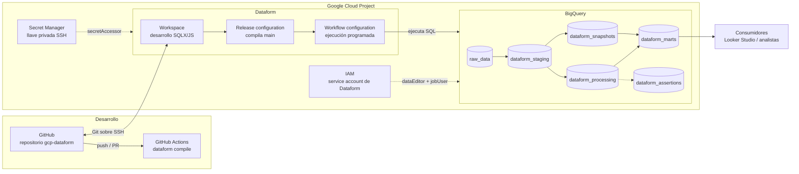
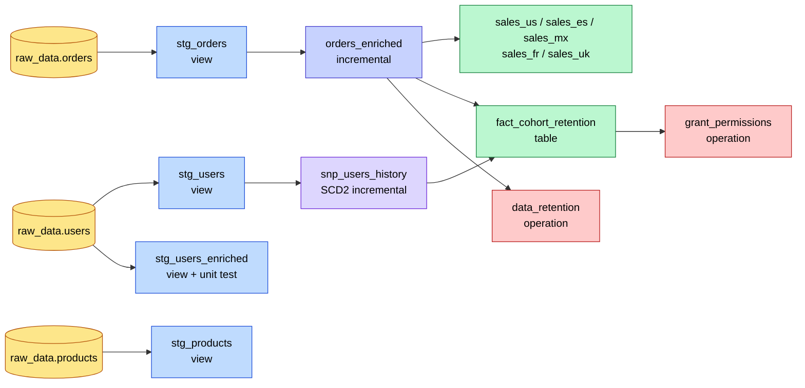
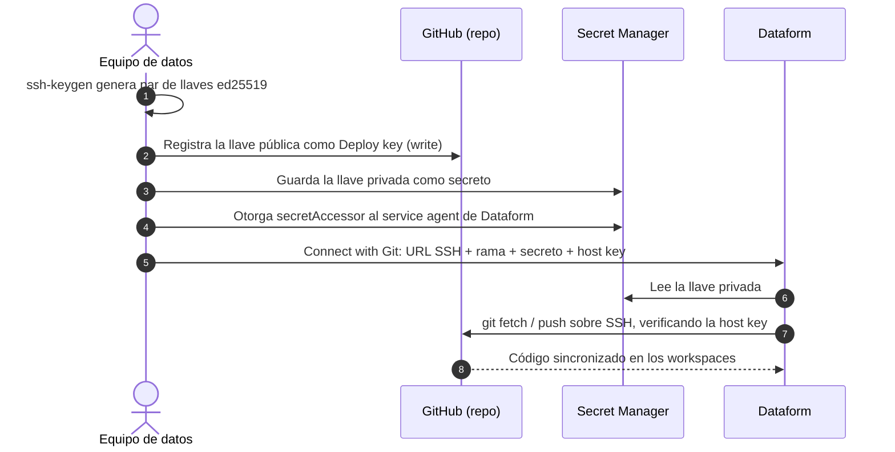

# Pipeline ELT analítico con Dataform y BigQuery

[](https://github.com/Dgelviz2688/gcp-dataform/actions/workflows/dataform-compile.yml)

Pipeline de datos **end-to-end** para un e-commerce construido con **Google Cloud Dataform** sobre **BigQuery**.
Transforma 1 millón de órdenes crudas en modelos analíticos listos para negocio (ventas regionales con impuestos y
retención de cohortes), aplicando prácticas de ingeniería de software al SQL: control de versiones con Git vía SSH,
modelado por capas, cargas incrementales, historización SCD Tipo 2, pruebas unitarias, aserciones de calidad,
gobierno de accesos e integración continua.

El proyecto está organizado en **6 laboratorios progresivos**: cada uno añade una capacidad nueva al pipeline y se
explica en detalle más abajo.

---

## Contenido

1. [Qué demuestra este proyecto](#qué-demuestra-este-proyecto)
2. [Arquitectura](#arquitectura)
3. [Servicios de Google Cloud utilizados](#servicios-de-google-cloud-utilizados)
4. [Conceptos clave de Dataform](#conceptos-clave-de-dataform)
5. [Estructura del repositorio](#estructura-del-repositorio)
6. [Guía de instalación paso a paso](#guía-de-instalación-paso-a-paso)
7. [Conexión SSH entre Dataform y GitHub](#conexión-ssh-entre-dataform-y-github)
8. [Laboratorios](#laboratorios)
9. [Calidad de datos y CI](#calidad-de-datos-y-ci)
10. [Orquestación en producción](#orquestación-en-producción)
11. [Desarrollo local con Dataform CLI](#desarrollo-local-con-dataform-cli)
12. [Decisiones técnicas y correcciones](#decisiones-técnicas-y-correcciones)
13. [Costos y limpieza](#costos-y-limpieza)

---

## Qué demuestra este proyecto

| Competencia | Dónde se aplica |
|---|---|
| Modelado por capas (raw → staging → processing → marts) | Labs 1–5 |
| Cargas incrementales con `MERGE`, particionado y clustering | Lab 3 – `orders_enriched` |
| Generación dinámica de modelos con JavaScript | Lab 4 – `regional_sales.js` |
| Historización de dimensiones (SCD Tipo 2) | Lab 5 – `snp_users_history` |
| Métricas de negocio: retención de cohortes | Lab 5 – `fact_cohort_retention` |
| Pruebas unitarias de SQL con datos simulados | Lab 2 – `test_stg_users_enriched` |
| Aserciones de calidad (unicidad, nulos) | Labs 3 y 5 |
| Gobierno de datos: permisos IAM y retención como código | Lab 6 – `ops/` |
| Git-ops: repositorio conectado por SSH, CI en GitHub Actions | Configuración y CI |
| Configuración parametrizada y sin secretos en el código | `workflow_settings.yaml` (`vars`) |

---

## Arquitectura

### Vista general



### Linaje de datos (DAG)

Este es el grafo real que Dataform compila a partir de las referencias `ref()` entre archivos:



### Capas del modelo

| Capa | Dataset BigQuery | Materialización | Responsabilidad |
|---|---|---|---|
| Raw | `raw_data` | Tablas de origen | Datos tal cual llegan del sistema transaccional. Dataform solo los **declara**. |
| Staging | `dataform_staging` | Vistas | Limpieza ligera: renombrado, tipado, estandarización y filtros de basura. Sin costo de almacenamiento. |
| Processing | `dataform_processing` | Incremental | Lógica de negocio pesada sobre volúmenes grandes; procesa solo lo nuevo. |
| Snapshots | `dataform_snapshots` | Incremental append-only | Historia de cambios de dimensiones (SCD Tipo 2). |
| Marts | `dataform_marts` | Tablas y vistas | Modelos finales orientados a una pregunta de negocio. |
| Assertions | `dataform_assertions` | Vistas generadas | Consultas de calidad que deben devolver 0 filas. |

---

## Servicios de Google Cloud utilizados

| Servicio | Definición | Uso en este proyecto |
|---|---|---|
| **BigQuery** | Data warehouse serverless y columnar de Google Cloud; separa almacenamiento y cómputo y factura por bytes procesados. | Almacena todas las capas y ejecuta cada transformación SQL. |
| **Dataform** | Servicio de Google Cloud para desarrollar, probar, versionar y orquestar transformaciones SQL en BigQuery (la "T" de ELT). Compila archivos SQLX/JS en un grafo de dependencias (DAG). | Define los modelos, sus dependencias, tests, aserciones y la ejecución programada. |
| **Secret Manager** | Almacén gestionado de secretos con control de acceso IAM y versionado. | Guarda la llave privada SSH con la que Dataform se autentica en GitHub. |
| **IAM** | Gestión de identidades y permisos de Google Cloud. | Otorga a la service account de Dataform los permisos mínimos sobre BigQuery y Secret Manager; el Lab 6 gestiona permisos de tabla como código. |
| **GitHub + GitHub Actions** | Control de versiones y CI/CD. | Repositorio remoto del proyecto Dataform y validación automática (`dataform compile`) en cada push y pull request. |

---

## Conceptos clave de Dataform

| Concepto | Qué es |
|---|---|
| **SQLX** | SQL extendido: un bloque `config { }` (metadatos) seguido de SQL. Permite insertar JavaScript con `${ }`. |
| **`ref("nombre")`** | Referencia a otra tabla del proyecto. Resuelve el nombre completo `proyecto.dataset.tabla` **y** crea la dependencia en el DAG, por lo que Dataform ejecuta todo en el orden correcto. |
| **`declaration`** | Registra una tabla externa (creada fuera de Dataform) para poder usarla con `ref()`. |
| **`view` / `table`** | Materializaciones clásicas: la vista se recalcula en cada consulta; la tabla se reconstruye completa en cada ejecución. |
| **`incremental`** | Tabla que en la primera ejecución se crea completa y en las siguientes solo inserta o hace `MERGE` de filas nuevas. `incremental()` indica en qué modo se está ejecutando y `self()` referencia a la propia tabla. |
| **`assertions`** | Reglas de calidad (`uniqueKey`, `nonNull`, `rowConditions`) que Dataform convierte en consultas; si devuelven filas, la ejecución falla. |
| **`test`** | Prueba unitaria: reemplaza las entradas de un modelo por datos simulados (`input`) y compara el resultado con una salida esperada. |
| **`operations`** | SQL arbitrario (DDL, DML, DCL) que no produce una tabla gestionada: permisos, mantenimiento, limpiezas. |
| **`includes/`** | Módulos JavaScript reutilizables (constantes, funciones) disponibles en todo el proyecto. |
| **Workspace** | Entorno de desarrollo aislado (equivalente a una rama de Git) dentro de Dataform. |
| **Release / Workflow configuration** | La release compila una rama a una hora dada; la workflow configuration ejecuta esa compilación con una frecuencia (cron) y una selección de acciones o tags. |

---

## Estructura del repositorio

```text
gcp-dataform/
├── workflow_settings.yaml          # Proyecto, ubicación, datasets por defecto, versión de Dataform y variables
├── includes/
│   └── constants.js                # Países, tasas de impuesto y tipo de materialización (Lab 4)
├── definitions/
│   ├── sources/                    # Lab 1 – declaraciones de las tablas raw
│   │   ├── raw_orders.sqlx
│   │   ├── raw_products.sqlx
│   │   └── raw_users.sqlx
│   ├── staging/                    # Lab 2 – limpieza (vistas) y prueba unitaria
│   │   ├── stg_orders.sqlx
│   │   ├── stg_products.sqlx
│   │   ├── stg_users.sqlx
│   │   ├── stg_users_enriched.sqlx
│   │   └── test_stg_users_enriched.sqlx
│   ├── processing/                 # Lab 3 – tabla incremental particionada
│   │   └── orders_enriched.sqlx
│   ├── marts/                      # Labs 4 y 5 – modelos de negocio
│   │   ├── regional_sales.js
│   │   └── fact_cohort_retention.sqlx
│   ├── snapshots/                  # Lab 5 – historial SCD Tipo 2
│   │   └── snp_users_history.sqlx
│   └── ops/                        # Lab 6 – gobierno: permisos y retención
│       ├── grant_permissions.js
│       └── data_retention.sqlx
├── scripts/
│   ├── setup.sh                    # Carga de datos sintéticos en BigQuery
│   ├── 01_create_raw_data.sql      # Genera users (50k), products (500), orders (1M)
│   └── 02_simulate_changes.sql     # Simula un nuevo día: órdenes nuevas y cambios de nivel
└── .github/workflows/
    └── dataform-compile.yml        # CI: compila el proyecto en cada push / PR
```

---

## Guía de instalación paso a paso

### Requisitos

- Un proyecto de Google Cloud con facturación habilitada.
- [Google Cloud CLI](https://cloud.google.com/sdk/docs/install) (`gcloud` y `bq`) autenticada con `gcloud auth login`.
- Una cuenta de GitHub.
- Opcional, para desarrollo local: Node.js 22 o superior.

### 1. Clonar el repositorio

```bash
git clone https://github.com/Dgelviz2688/gcp-dataform.git
cd gcp-dataform
```

Para conectar Dataform con **tu propia copia**, haz un *fork* del repositorio en GitHub y clona tu fork.

### 2. Configurar el proyecto de Google Cloud

```bash
export PROJECT_ID="tu-project-id"
export PROJECT_NUMBER=$(gcloud projects describe "$PROJECT_ID" --format='value(projectNumber)')
export DATAFORM_SA="service-${PROJECT_NUMBER}@gcp-sa-dataform.iam.gserviceaccount.com"

gcloud config set project "$PROJECT_ID"
gcloud services enable bigquery.googleapis.com dataform.googleapis.com secretmanager.googleapis.com
```

Edita `workflow_settings.yaml` y reemplaza el proyecto por el tuyo:

```yaml
defaultProject: "tu-project-id"
```

Es el **único** lugar donde aparece el ID del proyecto: las declaraciones de origen lo heredan de aquí.

### 3. Cargar los datos de origen

```bash
bash scripts/setup.sh "$PROJECT_ID"
```

Crea el dataset `raw_data` en la región `US` con tres tablas sintéticas:

| Tabla | Filas | Contenido |
|---|---|---|
| `raw_data.users` | 50.000 | Usuarios con nivel `VIP` (~10 %) o `Standard` |
| `raw_data.products` | 500 | Catálogo en 5 categorías con costo unitario |
| `raw_data.orders` | 1.000.000 | Órdenes de los últimos 2 años en 5 países (US, ES, MX, FR, UK) |

### 4. Crear el repositorio de Dataform

1. En la consola, abre **BigQuery → Dataform** y pulsa **Crear repositorio**.
2. Nombre: `gcp-dataform`; región: `us-central1` (o la más cercana; los datos se procesan en la ubicación `US` definida en `workflow_settings.yaml`).
3. Al crearlo, Dataform genera su *service agent*: `service-PROJECT_NUMBER@gcp-sa-dataform.iam.gserviceaccount.com`.

Otorga a ese service agent los permisos para ejecutar en BigQuery:

```bash
for ROLE in roles/bigquery.dataEditor roles/bigquery.jobUser; do
  gcloud projects add-iam-policy-binding "$PROJECT_ID" \
    --member="serviceAccount:${DATAFORM_SA}" --role="$ROLE"
done
```

> Si al crear el repositorio eliges una **service account personalizada** (recomendado en producción), otorga estos
> roles a esa cuenta y, además, concede al service agent de Dataform `roles/iam.serviceAccountUser` y
> `roles/iam.serviceAccountTokenCreator` sobre ella: Dataform aplica el modo *strict act-as* y la impersona para
> ejecutar los workflows.

### 5. Conectar el repositorio con GitHub por SSH

Sigue la sección [Conexión SSH entre Dataform y GitHub](#conexión-ssh-entre-dataform-y-github).

### 6. Crear un workspace, compilar y ejecutar

1. En el repositorio de Dataform, **Crear workspace** (por ejemplo `dev-tu-nombre`). Dataform trae el código de la rama `main`.
2. Abre el workspace: el panel **Compiled graph** debe mostrar el DAG sin errores.
3. Pulsa **Start execution → Execute actions → All actions** y marca **Run with full refresh** en la primera ejecución.
4. Ejecuta las pruebas unitarias desde la CLI (ver [Desarrollo local](#desarrollo-local-con-dataform-cli)) o revisa el resultado de las aserciones en **Executions**.

Al terminar, BigQuery contendrá los datasets `dataform_staging`, `dataform_processing`, `dataform_snapshots`,
`dataform_marts` y `dataform_assertions`.

---

## Conexión SSH entre Dataform y GitHub

Dataform guarda el código en un repositorio Git remoto. La autenticación por SSH con una **deploy key** limita el
acceso a un único repositorio y evita usar tokens personales con permisos sobre toda la cuenta.



### Paso 1 – Generar el par de llaves

```bash
ssh-keygen -t ed25519 -C "dataform-gcp" -f ./dataform_github -N ""
```

Genera `dataform_github` (privada) y `dataform_github.pub` (pública). Ambas están en `.gitignore` para que nunca se
suban al repositorio.

### Paso 2 – Registrar la llave pública en GitHub

1. En tu repositorio: **Settings → Deploy keys → Add deploy key**.
2. Título: `Dataform GCP`. Pega el contenido de `dataform_github.pub`.
3. Marca **Allow write access**: Dataform necesita hacer *push* de los commits creados desde los workspaces.

### Paso 3 – Guardar la llave privada en Secret Manager

```bash
gcloud secrets create dataform-github-ssh --replication-policy="automatic" \
  --data-file=./dataform_github

gcloud secrets add-iam-policy-binding dataform-github-ssh \
  --member="serviceAccount:${DATAFORM_SA}" \
  --role="roles/secretmanager.secretAccessor"
```

El permiso se concede **solo sobre ese secreto**, no a nivel de proyecto (principio de mínimo privilegio).

### Paso 4 – Obtener la llave pública del host de GitHub

Dataform verifica la identidad del servidor para evitar ataques *man-in-the-middle*. El formato esperado es
`ALGORITMO LLAVE_BASE64`:

```bash
ssh-keyscan -t ed25519 github.com 2>/dev/null | cut -d' ' -f2-
# ssh-ed25519 AAAAC3NzaC1lZDI1NTE5AAAAIOMqqnkVzrm0SdG6UOoqKLsabgH5C9okWi0dh2l9GKJl
```

Contrasta el valor con las huellas publicadas por GitHub en
[GitHub's SSH key fingerprints](https://docs.github.com/en/authentication/keeping-your-account-and-data-secure/githubs-ssh-key-fingerprints).

### Paso 5 – Vincular el repositorio en Dataform

En **Dataform → tu repositorio → Settings → Connect with Git**:

| Campo | Valor |
|---|---|
| Remote Git repository URL | `git@github.com:TU_USUARIO/gcp-dataform.git` |
| Default remote branch name | `main` |
| Secret | `dataform-github-ssh` |
| SSH public host key value | Salida del paso 4 (`ssh-ed25519 AAAA...`) |

Pulsa **Link**. Desde ese momento, cada workspace puede hacer *pull*, *commit* y *push* contra GitHub. Una vez
vinculado, borra las llaves locales: `rm dataform_github dataform_github.pub`.

---

## Laboratorios

Cada laboratorio corresponde a una etapa del desarrollo del pipeline. Para cada uno se explica el objetivo, cómo
funciona el código, cómo ejecutarlo y comprobarlo, y por qué las decisiones tomadas son relevantes en un entorno real.

### Lab 1 – Fundamentos: configuración del proyecto y declaración de fuentes

**Objetivo:** inicializar el proyecto Dataform y registrar las tablas de origen para que el resto del pipeline pueda
referenciarlas.

**Archivos:** `workflow_settings.yaml`, `definitions/sources/*.sqlx`, `scripts/`

**Cómo funciona**

`workflow_settings.yaml` es el archivo de configuración raíz. Define dónde se ejecuta todo y fija la versión del
compilador, lo que garantiza ejecuciones reproducibles:

```yaml
defaultProject: "gcp-dataform"          # proyecto de BigQuery
defaultLocation: "US"                   # ubicación de los datasets
defaultDataset: "dataform_staging"      # dataset si un modelo no indica schema
defaultAssertionDataset: "dataform_assertions"
dataformCoreVersion: "3.0.56"           # versión fija de @dataform/core
vars:
  reader_principal: ""                  # parámetros consumidos en el Lab 6
  retention_years: "5"
```

Las tablas de `raw_data` no las crea Dataform, sino el sistema de origen (aquí, `scripts/setup.sh`). Para usarlas se
**declaran**:

```sql
config {
    type: "declaration",
    schema: "raw_data",
    name: "orders",
    description: "Tabla transaccional de ventas"
}
```

A partir de aquí cualquier modelo puede escribir `${ref("orders")}` en lugar de un nombre de tabla fijo.

**Ejecutar y verificar**

```bash
bash scripts/setup.sh "$PROJECT_ID"
```

En el workspace, el grafo compilado muestra los tres nodos de origen. En BigQuery:

```sql
SELECT country, COUNT(*) AS orders, MIN(created_at) AS first_order, MAX(created_at) AS last_order
FROM raw_data.orders
GROUP BY country;
```

**Por qué importa:** declarar fuentes desacopla el pipeline de los nombres físicos. Si mañana el origen cambia de
proyecto o de dataset, se modifica una sola línea y Dataform sigue resolviendo todas las dependencias.

---

### Lab 2 – Capa staging y pruebas unitarias

**Objetivo:** construir una capa de limpieza sobre los datos crudos y validar la lógica con una prueba unitaria que
no depende de los datos reales.

**Archivos:** `definitions/staging/*.sqlx`

**Cómo funciona**

Los modelos de staging son **vistas** (`type: "view"`): no ocupan almacenamiento y siempre reflejan el último estado
del origen. Cada una aplica transformaciones mínimas y predecibles:

| Modelo | Transformaciones |
|---|---|
| `stg_orders` | Estados en mayúsculas (`UPPER(status)`), renombra `amount` → `sale_price`, deriva `order_date` y descarta importes `<= 0`. |
| `stg_users` | Rellena el nivel nulo con `'Standard'` mediante `COALESCE`. |
| `stg_products` | Renombra `cost` → `product_cost`. |
| `stg_users_enriched` | Regla de negocio: los usuarios VIP tienen un 15 % de descuento. |

```sql
SELECT
  order_id, user_id, product_id,
  UPPER(status) AS status,
  amount AS sale_price,
  country, created_at,
  DATE(created_at) AS order_date
FROM ${ref("orders")}
WHERE amount > 0
```

La regla de descuento se protege con una **prueba unitaria** (`test_stg_users_enriched.sqlx`). El bloque `input`
reemplaza la tabla `users` por dos filas controladas y el `SELECT` final define el resultado esperado:

```sql
config { type: "test", dataset: "stg_users_enriched" }

input "users" {
  SELECT 1 AS user_id, 'VIP' AS membership_tier UNION ALL
  SELECT 2 AS user_id, 'Standard' AS membership_tier
}

SELECT 1 AS user_id, 'VIP' AS membership_tier, 0.15 AS discount_rate UNION ALL
SELECT 2 AS user_id, 'Standard' AS membership_tier, 0.0 AS discount_rate
```

**Ejecutar y verificar**

```bash
dataform run --tags staging
dataform test        # Ejecuta test_stg_users_enriched: debe terminar en "passed"
```

Si alguien cambia el descuento VIP a 0.10 en `stg_users_enriched`, la prueba falla antes de que el cambio llegue a
producción.

**Por qué importa:** separar la limpieza de la lógica de negocio hace que los errores de calidad se corrijan en un solo
lugar, y las pruebas unitarias validan reglas de negocio de forma determinista, sin depender de datos que cambian.

---

### Lab 3 – Procesamiento incremental, particionado y clustering

**Objetivo:** procesar 1 millón de órdenes de forma eficiente: la primera ejecución carga todo y las siguientes solo
lo nuevo.

**Archivo:** `definitions/processing/orders_enriched.sqlx`

**Cómo funciona**

```sql
config {
  type: "incremental",
  schema: "dataform_processing",
  uniqueKey: ["order_id"],
  bigquery: {
    partitionBy: "DATE(created_at)",
    clusterBy: ["country", "status"]
  },
  assertions: {
    uniqueKey: ["order_id"],
    nonNull: ["order_id", "user_id", "created_at"]
  },
  tags: ["daily_run"]
}

pre_operations {
  DECLARE last_checkpoint DEFAULT (
    ${when(incremental(),
      `SELECT COALESCE(MAX(created_at), TIMESTAMP("2020-01-01")) FROM ${self()}`,
      `SELECT TIMESTAMP("2020-01-01")`
    )}
  )
}

SELECT ..., ROUND(o.sale_price * 0.30, 2) AS estimated_margin, CURRENT_TIMESTAMP() AS processed_at
FROM ${ref("stg_orders")} o
WHERE o.created_at > last_checkpoint
```

| Elemento | Función |
|---|---|
| `type: "incremental"` | Primera ejecución: `CREATE TABLE AS SELECT`. Siguientes: `MERGE` solo con las filas nuevas. |
| `uniqueKey` | Clave del `MERGE`: si una orden ya existe se actualiza en lugar de duplicarse (idempotencia). |
| `pre_operations` + `last_checkpoint` | Calcula **una sola vez** la marca de agua (la última fecha cargada) en una variable de script de BigQuery. |
| `when(incremental(), ...)` | Elige la lógica según el modo: en incremental lee `MAX(created_at)` de la propia tabla (`self()`); en carga completa parte de 2020. |
| `partitionBy` | Divide la tabla por día: las consultas filtradas por fecha solo leen las particiones necesarias. |
| `clusterBy` | Ordena los datos por país y estado, reduciendo los bytes escaneados en los filtros más comunes. |
| `assertions` | Tras cada carga, comprueba que no haya órdenes duplicadas ni claves nulas. |

**Ejecutar y verificar**

```bash
dataform run --tags daily_run --full-refresh   # 1ª vez: carga 1.000.000 de filas
bash scripts/setup.sh "$PROJECT_ID" --simulate   # llegan 10.000 órdenes nuevas
dataform run --tags daily_run                    # solo procesa las 10.000 nuevas
```

```sql
SELECT DATE(processed_at) AS load_date, COUNT(*) AS rows_loaded
FROM dataform_processing.orders_enriched
GROUP BY 1 ORDER BY 1;
```

En el historial de jobs de BigQuery (**Historial personal** o `INFORMATION_SCHEMA.JOBS`) se comparan los bytes procesados por la carga completa frente a la incremental.

**Por qué importa:** en producción, reprocesar la historia completa cada día multiplica costo y tiempo. La carga
incremental con marca de agua, combinada con particionado y clustering, es el patrón estándar para tablas de hechos
grandes en BigQuery.

---

### Lab 4 – Modelos dinámicos con JavaScript

**Objetivo:** generar cinco modelos de ventas regionales, cada uno con su impuesto, desde un único archivo y sin
duplicar SQL.

**Archivos:** `includes/constants.js`, `definitions/marts/regional_sales.js`

**Cómo funciona**

La configuración de cada país vive en un módulo reutilizable:

```javascript
const countries = [
    { code: "US", tax: 0.08, table_type: "table" },
    { code: "ES", tax: 0.21, table_type: "view" },
    { code: "MX", tax: 0.16, table_type: "table" },
    { code: "FR", tax: 0.20, table_type: "view" },
    { code: "UK", tax: 0.20, table_type: "table" }
];
```

`regional_sales.js` recorre la lista y llama a `publish()` por cada país. `publish()` es la API JavaScript de
Dataform equivalente a un archivo SQLX: recibe el nombre y la configuración, y `.query()` recibe el SQL con acceso a
`ctx.ref()`:

```javascript
constants.countries.forEach(country => {
    publish(`sales_${country.code.toLowerCase()}`, {
        type: country.table_type,
        schema: "dataform_marts",
        tags: ["regional_reports"]
    }).query(ctx => `
      SELECT order_id, user_id, sale_price,
             sale_price * ${country.tax} AS tax_amount,
             sale_price * (1 + ${country.tax}) AS total_amount_with_tax,
             '${country.code}' AS region_code
      FROM ${ctx.ref("orders_enriched")}
      WHERE country = '${country.code}'
    `);
});
```

Resultado: `sales_us`, `sales_mx` y `sales_uk` como tablas y `sales_es` y `sales_fr` como vistas, todos dependientes
de `orders_enriched`.

**Ejecutar y verificar**

```bash
dataform run --tags regional_reports
```

```sql
SELECT region_code, COUNT(*) AS orders, ROUND(SUM(tax_amount), 2) AS total_tax
FROM dataform_marts.sales_es
GROUP BY 1;
```

Para incorporar un nuevo país basta con añadir una línea en `constants.js`, por ejemplo
`{ code: "DE", tax: 0.19, table_type: "table" }` (y que existan órdenes de ese país en el origen).

**Por qué importa:** es el principio DRY aplicado a SQL. Cuando decenas de modelos comparten estructura, generarlos
por código elimina errores de copiar y pegar y convierte un cambio global en una modificación de una línea.

---

### Lab 5 – Historización SCD Tipo 2 y retención de cohortes

**Objetivo:** conservar la historia de cambios de los usuarios y construir un mart de retención mensual, una de las
métricas más usadas por producto y marketing.

**Archivos:** `definitions/snapshots/snp_users_history.sqlx`, `definitions/marts/fact_cohort_retention.sqlx`

**Cómo funciona: snapshot SCD Tipo 2**

Una dimensión de *Slowly Changing Dimension* Tipo 2 no sobrescribe los cambios: agrega una **nueva versión** de la
fila. El snapshot calcula una huella (`row_hash`) de los atributos versionados y, en cada ejecución incremental,
inserta solo los usuarios nuevos o aquellos cuya huella cambió respecto de su versión vigente:

```sql
WITH source AS (
  SELECT user_id, name, membership_tier, signup_date,
         FARM_FINGERPRINT(TO_JSON_STRING(STRUCT(name, membership_tier, signup_date))) AS row_hash
  FROM ${ref("stg_users")}
)
SELECT s.*, CURRENT_TIMESTAMP() AS valid_from
FROM source s
${when(incremental(), `
LEFT JOIN (
  SELECT user_id, row_hash FROM ${self()}
  WHERE TRUE
  QUALIFY ROW_NUMBER() OVER (PARTITION BY user_id ORDER BY valid_from DESC) = 1
) current_version ON s.user_id = current_version.user_id
WHERE current_version.row_hash IS NULL OR current_version.row_hash != s.row_hash
`)}
```

Al no tener `uniqueKey`, la tabla incremental funciona en modo *append-only*: nunca se pierde una versión anterior.

**Cómo funciona: retención de cohortes**

`fact_cohort_retention` agrupa a los usuarios por el mes de su primera compra (cohorte) y mide cuántos vuelven a
comprar en los meses siguientes:

| CTE | Cálculo |
|---|---|
| `first_purchase` | Mes de la primera compra de cada usuario. |
| `cohort_size` | Número de usuarios por cohorte. |
| `user_activities` | Para cada compra, `month_number` = meses transcurridos desde la primera compra. |
| `current_users` | Versión vigente de cada usuario en el snapshot (una fila por `user_id`). |

| Columna de salida | Significado |
|---|---|
| `cohort_month`, `month_number` | Cohorte y mes relativo (0 = mes de alta). |
| `cohort_size`, `active_users` | Tamaño de la cohorte y usuarios que compraron en ese mes. |
| `retention_rate` | `active_users / cohort_size`. |
| `total_revenue`, `vip_users` | Ingresos y usuarios VIP activos en ese mes. |

La tabla incluye aserciones que garantizan una sola fila por `(cohort_month, month_number)`.

**Ejecutar y verificar**

```bash
dataform run --tags daily_snapshot --full-refresh   # primera versión de los 50.000 usuarios
bash scripts/setup.sh "$PROJECT_ID" --simulate       # el 5 % de los usuarios cambia de nivel
dataform run --tags daily_snapshot                   # inserta solo las 2.500 versiones nuevas
dataform run --actions fact_cohort_retention
```

```sql
-- Historia de un usuario que cambió de nivel
SELECT user_id, membership_tier, valid_from
FROM dataform_snapshots.snp_users_history
WHERE user_id = 20
ORDER BY valid_from;

-- Matriz de retención (pivotar en Looker Studio o Sheets)
SELECT cohort_month, month_number, retention_rate
FROM dataform_marts.fact_cohort_retention
ORDER BY cohort_month, month_number;
```

**Por qué importa:** sin historización, un cambio de nivel reescribe el pasado y los análisis pierden trazabilidad.
La retención por cohortes responde a una pregunta clave del negocio: ¿los clientes que adquirimos vuelven a comprar?

---

### Lab 6 – Operaciones: gobierno de accesos y retención de datos

**Objetivo:** gestionar permisos y políticas de retención como código versionado, ejecutados dentro del mismo DAG.

**Archivos:** `definitions/ops/grant_permissions.js`, `definitions/ops/data_retention.sqlx`

**Cómo funciona**

Las acciones `operations` ejecutan SQL que no produce un modelo: aquí, una sentencia DCL (`GRANT`) y una DML
(`DELETE`). Ambas están parametrizadas con `vars` de `workflow_settings.yaml`, de modo que el código no contiene
identidades ni números de proyecto.

`grant_permissions.js` concede lectura sobre el mart de retención a un usuario o grupo, después de que la tabla se
construye:

```javascript
const readerPrincipal = dataform.projectConfig.vars.reader_principal;

operate("grant_permissions", {
  tags: ["security"],
  disabled: !readerPrincipal
}).queries(ctx => `
  GRANT \`roles/bigquery.dataViewer\`
  ON TABLE ${ctx.ref("fact_cohort_retention")}
  TO "${readerPrincipal}"
`);
```

Si `reader_principal` está vacío, la acción se compila **deshabilitada**: el pipeline funciona en cualquier proyecto
sin modificar código.

`data_retention.sqlx` aplica la política de conservación sobre `orders_enriched`:

```sql
DELETE FROM ${ref("orders_enriched")}
WHERE DATE(created_at) < DATE_SUB(CURRENT_DATE(), INTERVAL ${dataform.projectConfig.vars.retention_years} YEAR)
```

Como la tabla está particionada por fecha, BigQuery solo toca las particiones afectadas.

**Ejecutar y verificar**

1. En `workflow_settings.yaml`, define el principal: `reader_principal: "group:analytics@tu-dominio.com"`
   (formatos válidos: `user:`, `group:`, `serviceAccount:`, `domain:`).
2. La cuenta que ejecuta Dataform necesita `roles/bigquery.dataOwner` sobre el dataset `dataform_marts` para poder
   modificar permisos de tablas:

   ```bash
   bq add-iam-policy-binding --member="serviceAccount:${DATAFORM_SA}" \
     --role="roles/bigquery.dataOwner" "${PROJECT_ID}:dataform_marts"
   ```

3. Ejecuta:

   ```bash
   dataform run --tags security
   dataform run --tags maintenance
   ```

4. Comprueba el permiso con `bq get-iam-policy "${PROJECT_ID}:dataform_marts.fact_cohort_retention"`.

**Por qué importa:** cuando los permisos y la retención viven en el repositorio, cada cambio queda auditado en Git,
pasa por revisión en un pull request y se aplica de forma consistente en todos los entornos. Es la base de una
estrategia de gobierno de datos y de cumplimiento normativo (por ejemplo, plazos legales de conservación).

---

## Calidad de datos y CI

El pipeline tiene tres niveles de validación:

| Nivel | Herramienta | Cuándo se ejecuta | Qué detecta |
|---|---|---|---|
| Compilación | GitHub Actions (`dataform compile`) | En cada push a `main` y en cada pull request | Errores de sintaxis SQLX/JS, referencias rotas, dependencias circulares. |
| Pruebas unitarias | `dataform test` | Antes de publicar cambios | Reglas de negocio que dejan de cumplirse. |
| Aserciones | `assertions` en `orders_enriched` y `fact_cohort_retention` | En cada ejecución del pipeline | Duplicados y nulos en los datos reales. |

Las aserciones se materializan como vistas en `dataform_assertions`; si alguna devuelve filas, la ejecución se marca
como fallida y las acciones dependientes no se ejecutan.

---

## Orquestación en producción

Para ejecutar el pipeline de forma automática desde Dataform:

1. **Release configuration** (`Releases & scheduling → Create release configuration`): nombre `production`, rama
   `main`, frecuencia diaria. Compila el código publicado en `main`.
2. **Workflow configuration**: asociada a la release `production`, cron `0 6 * * *` (06:00 diario), con
   **All actions** seleccionado. Dataform resuelve el orden a partir del DAG: staging → processing / snapshots → marts →
   operaciones.

Con los tags definidos es posible separar frecuencias, por ejemplo `daily_run` y `daily_snapshot` cada día y
`regional_reports` cada hora.

---

## Desarrollo local con Dataform CLI

La CLI permite compilar, probar y ejecutar el proyecto desde la terminal (requiere Node.js 22 o superior):

```bash
npm install -g @dataform/cli@3

dataform compile                       # valida el proyecto y muestra las acciones
dataform init-creds                    # genera .df-credentials.json (ignorado por Git)
dataform run --dry-run                 # valida el SQL contra BigQuery sin ejecutarlo
dataform test                          # ejecuta las pruebas unitarias
dataform run --tags staging            # ejecuta solo las acciones con un tag
dataform run --actions orders_enriched --include-deps   # una acción y sus dependencias
dataform run --full-refresh            # reconstruye las tablas incrementales desde cero
```

---

## Decisiones técnicas y correcciones

Durante la revisión del proyecto se corrigieron los siguientes problemas, cada uno con su impacto:

| Problema | Impacto | Solución |
|---|---|---|
| `setup.sql` generaba fechas con `INTERVAL ... 365*2 HOUR` | Las órdenes cubrían solo ~30 días: el mart de cohortes tenía 2 filas | Rango de 2 años expresado en segundos: ~24 cohortes mensuales |
| `setup_v2.sql` recreaba `products` con 100 filas | El 80 % de las órdenes apuntaba a productos inexistentes | `products` se genera una sola vez con 500 filas; `02_simulate_changes.sql` simula cambios incrementales reales |
| ID de proyecto fijo en las declaraciones de origen | El proyecto no funcionaba en otro proyecto de GCP | Las declaraciones heredan `defaultProject`; un solo punto de configuración |
| `GRANT` a un service account con número de proyecto fijo | Fallaba en otros proyectos y exponía un identificador interno | Principal parametrizado en `vars`; acción deshabilitada si no se configura |
| Retención mezclada con permisos en una sola operación | Un fallo de permisos impedía aplicar la retención | Dos operaciones independientes con tags `security` y `maintenance` |
| `snp_users_history` hacía `MERGE` por `user_id` | Sobrescribía el nivel del usuario: no guardaba historia | Snapshot SCD Tipo 2 append-only con `row_hash` y `valid_from` |
| Checkpoint `MAX(created_at)` sin valor por defecto | Con la tabla vacía el filtro `> NULL` no cargaba nada | `COALESCE` con fecha inicial |
| Sin aserciones de calidad | Duplicados o nulos pasaban inadvertidos | Aserciones `uniqueKey` y `nonNull` en las tablas críticas |
| Sin validación automática | Errores de compilación detectados tarde | Workflow de GitHub Actions |

---

## Costos y limpieza

El volumen del proyecto (~100 MB) entra holgadamente en el nivel gratuito mensual de BigQuery (1 TB de consultas y
10 GB de almacenamiento). Dataform no tiene costo propio: solo se paga el procesamiento de BigQuery.

Para eliminar todos los recursos creados:

```bash
for DS in raw_data dataform_staging dataform_processing dataform_snapshots dataform_marts dataform_assertions; do
  bq rm -r -f -d "${PROJECT_ID}:${DS}"
done
gcloud secrets delete dataform-github-ssh
```

Y elimina el repositorio desde la consola de Dataform y la deploy key desde GitHub.

---

**Autoría:** Diana Gelviz · [github.com/Dgelviz2688](https://github.com/Dgelviz2688)
